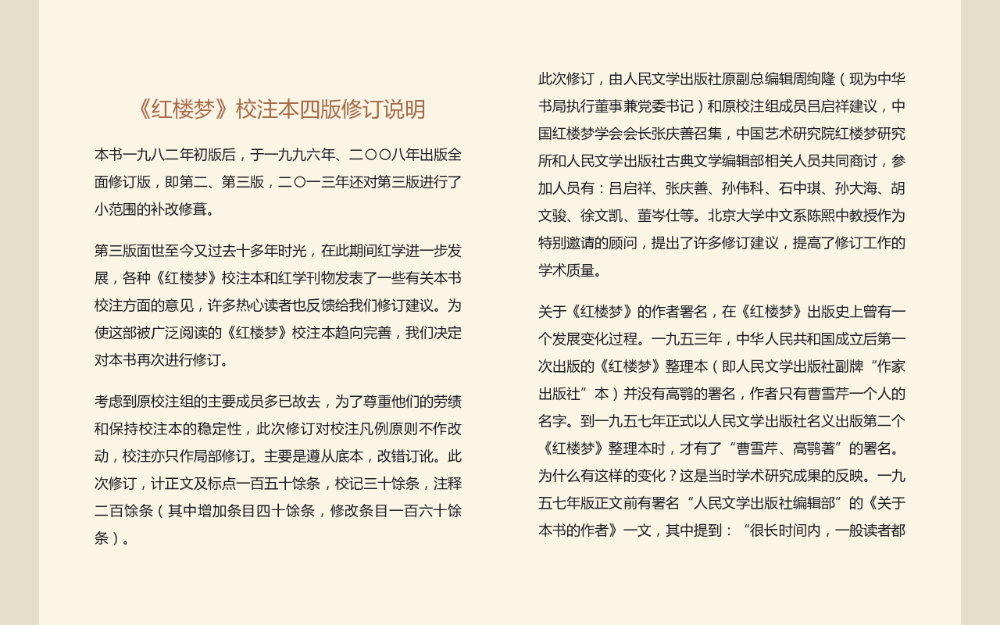
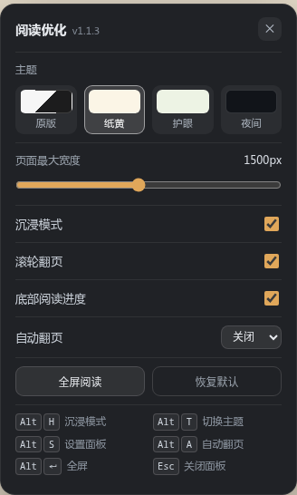
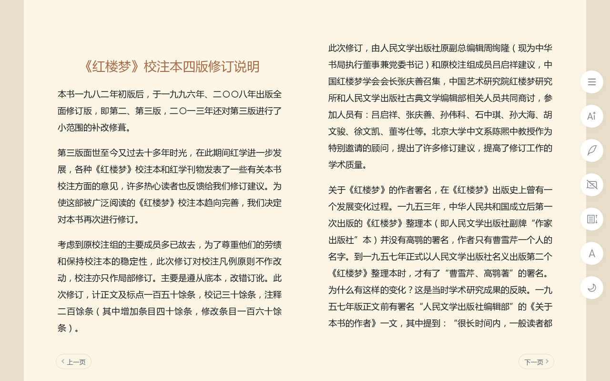
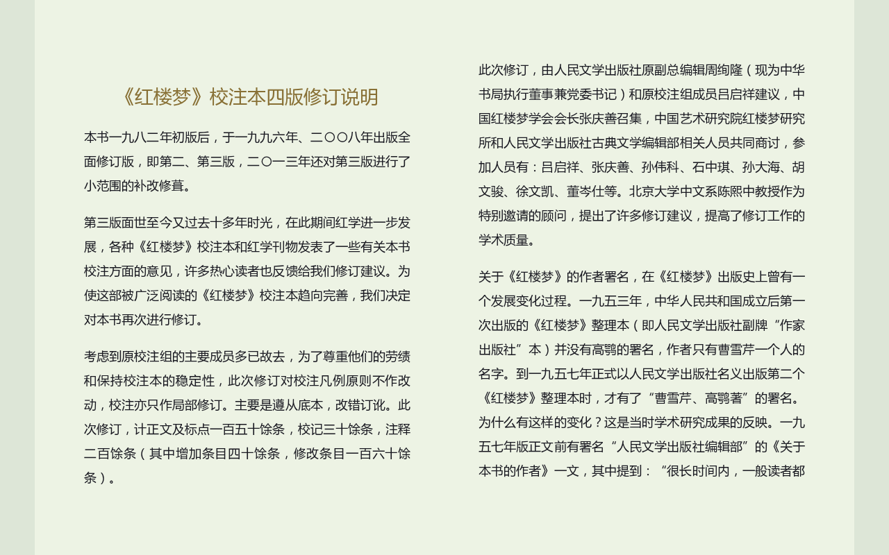
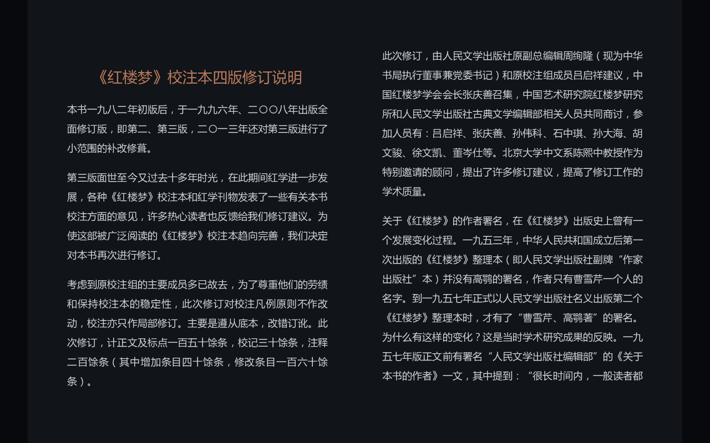

# 微信读书 · 沉浸阅读优化

一个给 [微信读书网页版](https://weread.qq.com/web/reader/) 阅读器用的油猴脚本（Tampermonkey / Violentmonkey）。

它把网页阅读器改造成更接近「读书」的样子：干净的沉浸界面、更宽的版面、纸感/护眼/夜间配色、底部阅读进度，以及滚轮翻页、自动翻页和一组快捷键。



## 功能

- **沉浸模式**：隐藏顶部工具栏、右侧悬浮按钮和底部翻页按钮，正文占满整个窗口；鼠标移到屏幕上/右/下边缘时，对应控件会淡入。
- **更宽的版面**：阅读区最大宽度可在 900–2200px 之间调节（默认 1500px，且不超过窗口的 92%），同时去掉顶部 72px、底部 60px 的留白，一屏能多读几行。
- **三种配色**：纸黄、护眼绿、夜间，另可切回原版。正文、章节标题、页面底色、顶部工具栏会一起变化；正文换色只作用于文字画布，不会给插图染色。
- **底部阅读进度**：一条细进度条，悬停显示「第几章 / 共几章 · 百分比 · 章节名」。
- **滚轮翻页**：在阅读区滚动鼠标滚轮即可上一页/下一页（带 700ms 防抖，选中文字或打开面板时自动失效）。
- **自动翻页**：15/30/60 秒可选，顶部会显示一个可随时停止的小提示。
- **快捷键**：`Alt+H` 沉浸模式、`Alt+T` 切换主题、`Alt+S` / `Alt+,` 设置面板、`Alt+A` 自动翻页、`Alt+Enter` 全屏、`Esc` 关闭面板。
- **设置持久化**：所有选项通过 GM 存储保存（没有 GM 时退回 localStorage），换书、刷新都保留。

<p align="center">
  
</p>

## 安装

1. 先安装用户脚本管理器：[Tampermonkey](https://www.tampermonkey.net/) 或 [Violentmonkey](https://violentmonkey.github.io/)。
2. 打开管理器的「添加新脚本」，把 [`weread-beautify.user.js`](weread-beautify.user.js) 的全部内容粘贴进去保存；也可以直接把 `.user.js` 文件拖进浏览器窗口。
3. 打开任意微信读书阅读页（形如 `https://weread.qq.com/web/reader/...`），左下角会出现一个橙色圆形按钮；首次安装还会在按钮旁弹出提示。也可以按 `Alt+S` / `Alt+,` 打开设置。

> 脚本只在 `weread.qq.com/web/reader/*` 下运行，不会改动书架、书城等其他页面。

左下角的入口长这样（首次安装会显示提示气泡）：


## 使用说明

- 默认开启「纸黄 + 沉浸模式 + 滚轮翻页 + 底部进度」。
- 鼠标移动到**顶部**可以唤出原站顶栏（书名、加入书架等），移动到**右侧**唤出工具栏（目录、字号、AI 等），移动到**底部**唤出翻页按钮；1.8–2.2 秒后自动隐藏。
- 想固定显示顶栏和按钮时，在设置面板里关掉「沉浸模式」。
- 阅读进度按目录章节序号估算：微信读书网页版没有暴露精确页码 API，所以进度条反映的是「读到第几章」，不是页内百分比。

鼠标移到右侧时，工具栏会淡入；移开后自动隐藏：



<table>
  <tr>
    <td></td>
    <td></td>
  </tr>
  <tr>
    <td align="center">护眼</td>
    <td align="center">夜间</td>
  </tr>
</table>

## 看不到入口 / 打不开设置？

先确认脚本确实运行了。按 `F12` 打开控制台，刷新阅读页，正常会看到两行日志：

```
[weread-beautify] v1.1.3 已加载，等待阅读器就绪
[weread-beautify] 阅读器 UI 已就绪，入口在左下角，也可按 Alt+S / Alt+, 打开
```

**两行都没有**：脚本没被注入。

- 确认脚本在油猴面板里是启用状态，`@match` 没被改动；
- 确认地址栏是 `/web/reader/...` 的阅读页（书城、书籍详情页不会运行）；
- 安装或更新脚本后要刷新一次阅读页；
- 先停用其他阅读类脚本再排查。

**只有第一行**：脚本运行了但界面创建失败，页面左下角会出现红色错误条，把控制台里 `[weread-beautify]` 的报错发我。

**两行都有但看不到按钮**：最常见的原因是**广告拦截插件把浮层当广告隐藏了**（例如过滤规则 `head ~ div[style*="z-index"]` 会误伤挂在 `<html>` 下的浮层）。v1.1.2 已把浮层改挂到 `<body>` 下，并用内联 `!important` 强制可见；如果仍然被拦截，请把 `weread.qq.com` 加入广告拦截插件的白名单。

也可以直接打开面板：

```js
document.getElementById('wrbf-ui').shadowRoot.getElementById('launcher').click()
```

或者从油猴的脚本菜单里选择「打开设置面板」。

## 实现说明

微信读书网页版的正文不是 DOM 文字，而是画在 `<canvas>` 上的，因此：

- **不能**用 CSS 改正文字体、字号、行距——脚本只调整 `.readerChapterContent` 的宽高，然后派发一次 `resize` 事件，让官方阅读器按新尺寸重新分页；
- 换色用 `filter` 作用在正文画布上（`.wr_canvasContainer canvas`），页面底色用 CSS 覆盖。站点自带浅色/深色主题时，脚本会自动选择「加深」或「反相」的滤镜；
- 遮罩、目录、评论等面板不受主题影响，保持站点原样，避免误伤交互。

脚本对缺失的 DOM 都做了兜底：找不到目录、翻页按钮或章节标题时会静默降级，不会报错。

## 已知限制

- 仅针对桌面端浏览器；移动端触摸屏没有「鼠标移到边缘」的交互。
- 微信读书阅读器改版后，个别 CSS 选择器可能失效；届时更新脚本即可。
- 「纸黄/护眼」在站点深色主题下会对画布做反相，极少数带透明度的高亮标记颜色可能略有偏差。

## 开发与测试

```bash
npm install
node test/run.js
```

`test/run.js` 用 jsdom 构造了一个模拟阅读器 DOM，覆盖了初始化、主题切换、快捷键、滚轮翻页、自动翻页、进度计算、设置持久化等逻辑。

## License

[MIT](LICENSE)
